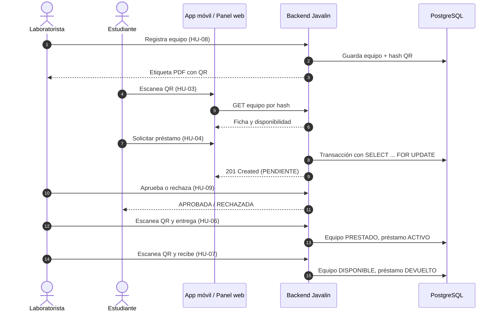
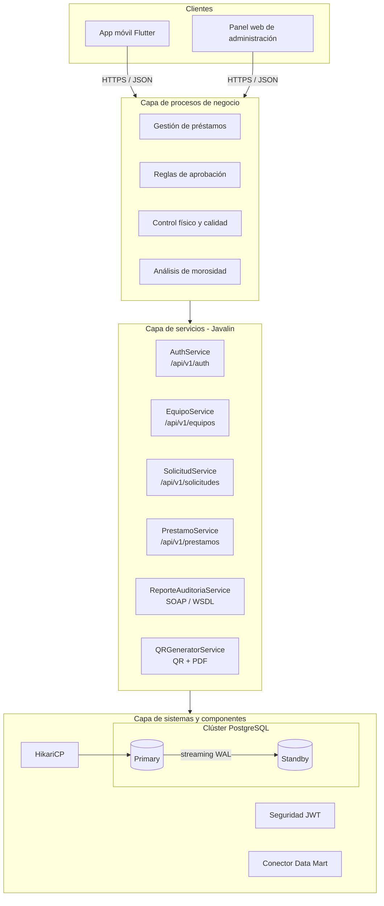
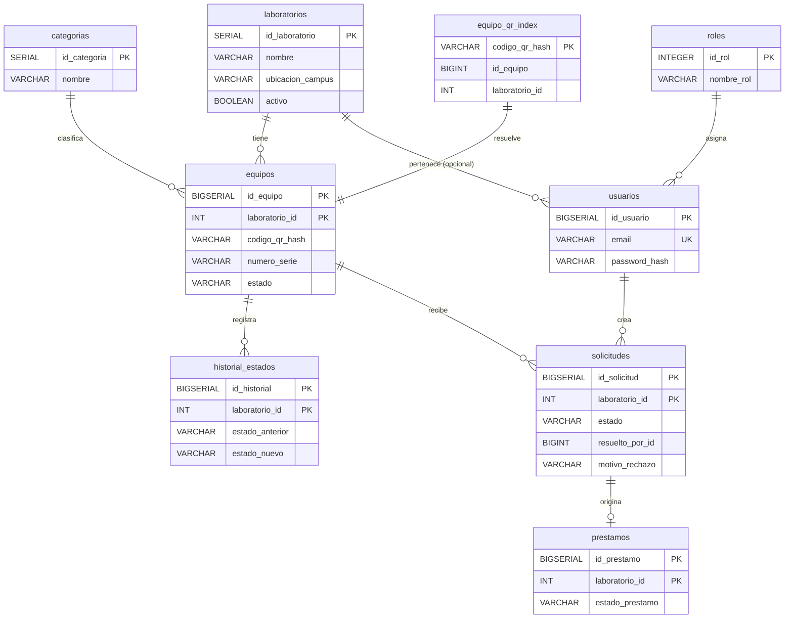

# 📱 Sistema Móvil de Préstamo de Equipos mediante Códigos QR


Sistema que sustituye las bitácoras en papel de los laboratorios de la UNACH por un préstamo de equipos con **códigos QR**, con trazabilidad en tiempo real y datos distribuidos por laboratorio.

---

## 📑 Tabla de contenido

1. [Contexto y problemática](#-contexto-y-problemática)
2. [Propuesta de solución](#-propuesta-de-solución)
3. [Roles de usuario](#-roles-de-usuario)
4. [Alcance y exclusiones](#-alcance-y-exclusiones)
5. [Flujo operativo (MVP)](#-flujo-operativo-mvp)
6. [Arquitectura](#-arquitectura)
7. [Stack tecnológico](#-stack-tecnológico)
8. [Base de datos distribuida](#-base-de-datos-distribuida)
9. [Historias de usuario](#-historias-de-usuario)
10. [Requisitos](#-requisitos)
11. [API (resumen)](#-api-resumen)
12. [Estructura del repositorio](#-estructura-del-repositorio)
13. [Instalación y ejecución](#-instalación-y-ejecución)
14. [Pruebas y calidad](#-pruebas-y-calidad)
15. [Estimaciones y plan de sprints](#-estimaciones-y-plan-de-sprints)
16. [Flujo de trabajo en GitHub](#-flujo-de-trabajo-en-github)
17. [Inteligencia de negocios y minería de datos](#-inteligencia-de-negocios-y-minería-de-datos)
18. [Equipo](#-equipo)
19. [Licencia](#-licencia)

---

## 🎯 Contexto y problemática

En las facultades y laboratorios de la UNACH, los equipos tecnológicos (laptops, osciloscopios, kits de robótica, proyectores, multímetros y herramientas especializadas) se controlan en bitácoras de papel u hojas de cálculo locales. Esto genera:

- **Falta de trazabilidad en tiempo real:** no se sabe quién tiene un equipo, dónde está ni cuándo debe volver.
- **Cuellos de botella en horas pico:** filas mientras se llenan formularios en papel.
- **Pérdida y deterioro no atribuible:** no se registra el estado físico en la entrega y la devolución.
- **Subutilización del inventario:** no hay visibilidad de equipos disponibles en laboratorios contiguos.

## 💡 Propuesta de solución

Una solución integral bajo una **arquitectura orientada a servicios (SOA)**:

- Backend centralizado en **Javalin (Java/Kotlin)** con servicios **REST (JSON)** y **SOAP (XML)**.
- App móvil multiplataforma en **Flutter** con escáner QR de alta velocidad.
- Panel administrativo web para laboratoristas y administradores.
- Clúster **PostgreSQL** Primary-Standby con replicación y failover automático.
- Módulo de **inteligencia de negocios** (Data Mart en estrella, cubos OLAP) y **modelos predictivos** de desgaste de equipos y morosidad.

## 👥 Roles de usuario

| Rol | Qué hace |
| --- | --- |
| **Solicitante** (estudiante o docente) | Consulta el catálogo, escanea etiquetas QR, solicita préstamos y revisa sus préstamos activos e historial. |
| **Responsable de equipos** (laboratorista) | Gestiona el inventario de su laboratorio, aprueba o rechaza solicitudes, entrega y recibe equipos por QR, registra el estado físico y genera etiquetas QR. |
| **Administrador** | Supervisa el inventario global, administra cuentas, roles y laboratorios, monitorea el clúster y analiza tableros y modelos predictivos. |

## 🚧 Alcance y exclusiones

**Incluye**

- Autenticación con JWT y contraseñas cifradas con BCrypt.
- Catálogo de equipos por laboratorio con estados: `DISPONIBLE`, `PRESTADO`, `EN MANTENIMIENTO`, `DADO DE BAJA`.
- Generación de QR únicos con hash criptográfico y exportación a PDF para etiquetado.
- App móvil con escáner nativo y procesamiento inmediato de solicitudes.
- Backend en capas SOA (REST para clientes, SOAP para reportes y auditorías).
- Fragmentación horizontal por `laboratorio_id` sobre PostgreSQL.
- Clúster Primary-Standby para alta disponibilidad.
- Data Mart en estrella y modelos de minería de datos.

**Fuera de alcance**

- ❌ Pagos o cobro de multas.
- ❌ Cerraduras electrónicas o apertura automática por Bluetooth/NFC.
- ❌ Reconocimiento facial.
- ❌ Operación totalmente offline sin sincronización posterior.

## 🔄 Flujo operativo (MVP)



1. **Alta e impresión.** El laboratorista registra el equipo; el backend genera el QR y la etiqueta PDF.
2. **Consulta QR.** El estudiante escanea y ve ficha técnica y disponibilidad en tiempo real.
3. **Solicitud.** Se valida que el equipo esté `DISPONIBLE` y que el alumno no tenga bloqueos; queda `PENDIENTE`.
4. **Aprobación.** El laboratorista aprueba o rechaza (con motivo).
5. **Entrega física.** Solo con solicitud `APROBADA`; el equipo pasa a `PRESTADO`.
6. **Devolución.** Se captura el estado físico y el equipo vuelve a `DISPONIBLE` (o `Mantenimiento` si hay daño).

## 🏗️ Arquitectura

Tres capas SOA: los clientes solo hablan con los servicios, y solo los servicios acceden al clúster PostgreSQL.



**Contenedores (C4 nivel 2).** En Docker corren el backend Javalin y el clúster PostgreSQL (red `prestamos_qr_network`). La app móvil y el panel web viven en el dispositivo o navegador del usuario.

## 🧰 Stack tecnológico

| Capa | Tecnología |
| --- | --- |
| Backend | Java / Kotlin + **Javalin**, HikariCP, Jackson |
| Servicios | REST (JSON) y SOAP (XML / WSDL) |
| Documentación API | Swagger / OpenAPI |
| App móvil | **Flutter** (Android e iOS) |
| Panel web | React, Vue o HTML servido por Javalin |
| Seguridad | JWT (RSA o HMAC), BCrypt (costo 10), HTTPS |
| Base de datos | **PostgreSQL** con particionamiento `LIST` por `laboratorio_id` |
| Alta disponibilidad | Streaming Replication, Patroni, PgBouncer (opcional) |
| Contenedores | Docker y Docker Compose |
| Gestión | Git, Gitflow, GitHub Projects (Kanban), GitHub Actions |
| BI / Minería | Data Mart en estrella, cubos OLAP, Random Forest / C4.5 (J48) |

## 🗄️ Base de datos distribuida

Las tablas `equipos`, `solicitudes`, `prestamos` e `historial_estados` se fragmentan horizontalmente con **particionamiento `LIST` por `laboratorio_id`**. El resto son tablas globales.



Consecuencias de PostgreSQL ya resueltas en el diseño:

- **Claves únicas:** toda PK o `UNIQUE` incluye `laboratorio_id`; por eso `codigo_qr_hash` y `numero_serie` son únicos *por laboratorio*.
- **Búsqueda por QR:** la tabla global `equipo_qr_index` resuelve `id_equipo` y `laboratorio_id` a partir del hash, antes de consultar la partición.
- **Claves foráneas:** las que apuntan a tablas particionadas son compuestas `(id, laboratorio_id)`.

```sql
CREATE TABLE equipos (
    id_equipo      BIGSERIAL,
    laboratorio_id INT NOT NULL REFERENCES laboratorios,
    codigo_qr_hash VARCHAR(255) NOT NULL,
    numero_serie   VARCHAR(100) NOT NULL,
    estado         VARCHAR(20)  NOT NULL,
    -- demás columnas según el diseño
    PRIMARY KEY (id_equipo, laboratorio_id),
    UNIQUE (laboratorio_id, codigo_qr_hash),
    UNIQUE (laboratorio_id, numero_serie)
) PARTITION BY LIST (laboratorio_id);

CREATE TABLE equipos_lab1 PARTITION OF equipos FOR VALUES IN (1);
CREATE TABLE equipos_lab2 PARTITION OF equipos FOR VALUES IN (2);
CREATE TABLE equipos_lab3 PARTITION OF equipos FOR VALUES IN (3);
```

> En el MVP todas las particiones viven en el mismo clúster Primary-Standby. Separarlas en servidores distintos (`postgres_fdw` o Citus) queda como evolución.

**Alta disponibilidad.** Un nodo Primary recibe las escrituras y un Standby queda en solo lectura (Streaming Replication, síncrona o asíncrona). **Patroni** monitorea el Primary y promueve el Standby si falla; la interrupción dura segundos (no es "cero"). PgBouncer es opcional como pooler.

## 📖 Historias de usuario

9 historias · **42 Story Points**.

| ID | Historia | Épica | SP | Prioridad |
| --- | --- | --- | :-: | --- |
| HU-01 | Iniciar sesión | EP-01 | 3 | Alta |
| HU-02 | Consultar catálogo de equipos | EP-02 | 3 | Alta |
| HU-03 | Escanear código QR de equipo | EP-03 | 5 | Alta |
| HU-04 | Solicitar préstamo de equipo | EP-04 | 8 | Alta |
| HU-05 | Consultar mis préstamos | EP-04 | 3 | Alta |
| HU-06 | Registrar entrega física por QR | EP-05 | 5 | Alta |
| HU-07 | Registrar devolución por QR | EP-05 | 5 | Alta |
| HU-08 | Registrar equipo y generar etiqueta QR | EP-02 | 5 | Media |
| HU-09 | Aprobar o rechazar solicitud | EP-04 | 5 | Alta |

**Épicas:** EP-01 Usuarios y autenticación · EP-02 Equipos e inventario distribuido · EP-03 Generación y escaneo de QR · EP-04 Solicitudes y préstamos · EP-05 Entregas, devoluciones y control físico.

## ✅ Requisitos

### Funcionales

| Código | Requisito | Historia(s) |
| --- | --- | --- |
| RF-01 | Autenticación con credenciales únicas y token JWT | HU-01 |
| RF-02 | Administración de roles y asignación a laboratorios | HU-01 |
| RF-03 | Catálogo de equipos con filtros y estados | HU-02, HU-08 |
| RF-04 | Generación de QR con hash y exportación a PDF | HU-08 |
| RF-05 | Lector nativo de QR integrado a REST | HU-03 |
| RF-06 | Solicitudes de préstamo transaccionales y atómicas | HU-04 |
| RF-07 | Aprobación o rechazo de solicitudes | HU-09 |
| RF-08 | Registro de entregas con escaneo QR | HU-06 |
| RF-09 | Registro de devoluciones con inspección | HU-07 |
| RF-10 | Historial personal y bitácora general | HU-05 |

### No funcionales

| Código | Categoría | Requisito |
| --- | --- | --- |
| RNF-01 | Seguridad | BCrypt, HTTPS y endpoints protegidos con JWT firmado |
| RNF-02 | Arquitectura | Backend Javalin con REST (JSON) y SOAP (XML) |
| RNF-03 | Persistencia | PostgreSQL con fragmentación por `laboratorio_id` en clúster de alta disponibilidad |
| RNF-04 | Rendimiento | Validación de QR y disponibilidad en menos de 2.0 s |
| RNF-05 | Mantenibilidad | Gitflow, al menos un PR revisado y pruebas automatizadas en verde |

## 🔌 API (resumen)

Base: `/api/v1`. Los endpoints se protegen con `Authorization: Bearer <JWT>`.

| Servicio | Ruta base | Tipo |
| --- | --- | --- |
| AuthService | `/api/v1/auth` | REST |
| EquipoService | `/api/v1/equipos` | REST |
| SolicitudService | `/api/v1/solicitudes` | REST |
| PrestamoService | `/api/v1/prestamos` | REST |
| ReporteAuditoriaService | *(definir ruta WSDL)* | SOAP |

**Códigos de respuesta clave**

| Código | Cuándo |
| --- | --- |
| `200` | Login correcto; solicitud aprobada |
| `201` | Solicitud creada en estado `PENDIENTE` |
| `400` | Alumno con préstamos vencidos o sanciones |
| `401` | Credenciales inválidas |
| `403` | Cuenta inactiva |
| `409` | Ya existe una solicitud `PENDIENTE` o `APROBADA` sobre el equipo; o la solicitud ya fue resuelta |

La documentación interactiva se expone con **Swagger UI** (OpenAPI) en el backend.

## 📂 Estructura del repositorio

```text
.
├── docs/
│   ├── arquitectura_soa/          # Diagramas UML 2.0 y C4
│   ├── base_datos_distribuida/    # Scripts DDL/DML PostgreSQL y diagramas DER
│   └── estimaciones/              # Hojas de cálculo PERT y COCOMO
├── backend-javalin/
│   ├── src/main/java/             # Controladores, servicios y DAOs
│   ├── Dockerfile                 # Contenedor del backend
│   └── pom.xml                    # Dependencias Maven (Javalin, HikariCP, Jackson)
├── frontend-mobile/
│   ├── lib/                       # Flutter: vistas, widgets, servicios REST, escáner QR
│   └── pubspec.yaml
├── frontend-web/
│   └── src/                       # Panel web de administración
├── infra/                         # docker-compose.yml y configuración del clúster PostgreSQL
├── .github/                       # Workflows de CI y plantilla de Pull Request
└── README.md
```

## ⚙️ Instalación y ejecución

> Los comandos son una guía base. Ajusta nombres de archivos, versiones y variables a lo que exista realmente en tu repositorio.

### Requisitos previos

- Git
- Docker y Docker Compose
- JDK (versión según tu `pom.xml`) y Maven
- Flutter SDK (para la app móvil)
- Node.js (solo si el panel web usa React o Vue)

### 1. Clonar el repositorio

```bash
git clone https://github.com/<usuario>/<repositorio>.git
cd <repositorio>
```

### 2. Variables de entorno

Crea un archivo `.env` en `/infra` (ejemplo, valores de muestra):

```env
POSTGRES_USER=prestamos_admin
POSTGRES_PASSWORD=cambia_esta_contraseña
POSTGRES_DB=prestamos_qr
JWT_SECRET=cambia_este_secreto
```

> ⚠️ No subas el archivo `.env` al repositorio. Agrégalo a `.gitignore`.

### 3. Levantar el clúster PostgreSQL y el backend

```bash
docker compose -f infra/docker-compose.yml up -d
```

Los servicios corren en la red Docker `prestamos_qr_network`.

### 4. Backend (modo desarrollo)

```bash
cd backend-javalin
mvn clean package
java -jar target/<nombre-del-jar>.jar
```

### 5. App móvil

```bash
cd frontend-mobile
flutter pub get
flutter run
```

### 6. Panel web

```bash
cd frontend-web
npm install
npm run dev
```

## 🧪 Pruebas y calidad

- **Definition of Done:** historia con criterios de aceptación cumplidos, pruebas en verde y PR aprobado.
- **Pruebas unitarias y de integración** automatizadas en CI (GitHub Actions, carpeta `.github/workflows`).
- **Revisión de código:** todo cambio entra por Pull Request a `develop`, revisado por al menos otro integrante (RNF-05).

```bash
# Backend
cd backend-javalin && mvn test

# Móvil
cd frontend-mobile && flutter test
```

## 📊 Estimaciones y plan de sprints

**PERT de tres puntos:** `E = (O + 4M + P) / 6` → **128.83 h** para las 9 historias.

| Sprint | Enfoque | Historias | Horas PERT |
| :-: | --- | --- | :-: |
| 1 | Fundación y servicios backend | HU-01, HU-02, HU-08 | 36.83 |
| 2 | Clientes móvil y web, escáner QR, flujo transaccional | HU-03, HU-04, HU-06, HU-07, HU-09 | 81.67 |
| 3 | Clúster PostgreSQL, analítica y pruebas | HU-05 | 10.33 |

- **Equipo:** 5 desarrolladores × 20 h/semana = 100 h/semana (300 h en 3 semanas).
- Las horas PERT cubren solo la codificación y pruebas unitarias; el resto (≈171 h) es trabajo habilitador: esquema, clúster, CI, Data Mart, modelos predictivos, SOAP, pruebas de carga y documentación.
- **COCOMO Básico (orgánico, 5.0 KLOC):** 13.0 personas-mes en 6.6 meses para el ciclo de vida completo del producto institucional.
- **Presupuesto estimado:** $81,856.50 MXN (tarifa de referencia $500/h, incluye 10 % de contingencia).

## 🌿 Flujo de trabajo en GitHub

### Ramas (Gitflow)

| Rama | Uso |
| --- | --- |
| `main` | Producción estable |
| `develop` | Integración continua |
| `feature/HU-XX-nombre` | Desarrollo de una historia |
| `bugfix/nombre-error` | Corrección de errores |

### Commits (Conventional Commits)

```text
feat(auth): agrega emisión de token JWT
fix(solicitudes): corrige validación de solicitud duplicada
docs(readme): actualiza instrucciones de instalación
```

### Tablero Kanban (GitHub Projects)

`Backlog` → `Ready` → `In Progress` → `In Review (PR)` → `Done`

Una historia solo pasa a **Done** cuando su Pull Request está integrado y se cumple la Definition of Done.

### Plantilla de Pull Request (`.github/pull_request_template.md`)

```markdown
## Descripción
<!-- Qué cambia y por qué -->

## Historia relacionada
Closes #<número-de-issue> (HU-XX)

## Checklist
- [ ] Cumple los criterios de aceptación
- [ ] Pruebas automatizadas en verde
- [ ] Documentación actualizada (si aplica)
- [ ] Revisado por al menos un integrante
```

## 🧠 Inteligencia de negocios y minería de datos

**Data Mart (esquema estrella):** `Fact_Prestamos` con `tiempo_id`, `equipo_id`, `usuario_id`, `laboratorio_id` y métricas `duracion_prestamo_horas`, `dias_retraso`, `es_devolucion_con_dano`, `cantidad_prestamos`; dimensiones `Dim_Tiempo`, `Dim_Equipo`, `Dim_Usuario` y `Dim_Laboratorio`.

| Modelo | Algoritmo | Resultado |
| --- | --- | --- |
| Desgaste y mantenimiento preventivo | Regresión logística o Random Forest | Probabilidad (0.0 a 1.0) de falla en 15 días |
| Morosidad de alumnos | Árboles de decisión (C4.5 / J48) | Riesgo: Bajo, Moderado o Alto |

**Escalabilidad Big Data (fases futuras):** migración a Apache Spark, Hadoop y Data Lakes para logs y telemetría de sensores IoT.

## 🎓 Equipo

**Equipo Gigantes_Acero** · Universidad Autónoma de Chiapas · Facultad de Negocios · Campus IV · Escuela de Tecnologías Digitales Aplicadas

| Integrante |
| --- |
| Jorge Luis Calvo Zavala |
| Jesús Elias Cárdenas García |
| Alessandro Churape Canel |
| Aura Michelle Palomeque Rasgado |
| Alan Dario Vidal Lopez |

**Profesor:** ISC. MCC. Ernaes Antonio Trujillo Vizuet

**Asignaturas integradas:** Calidad en los Procesos de Desarrollo de Software · Taller de Desarrollo 3 · Tópicos Avanzados de Bases de Datos

## 📄 Licencia

Proyecto académico de la UNACH. Define aquí la licencia que prefieras (por ejemplo MIT) y agrega el archivo `LICENSE` al repositorio.
